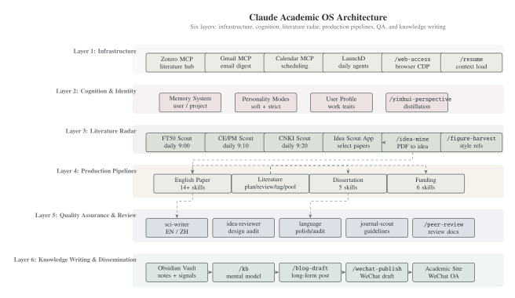
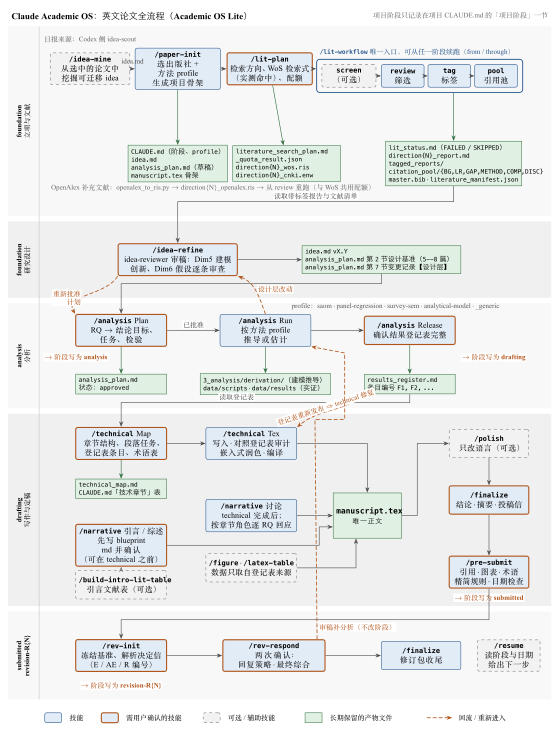

# Claude Academic OS

A personal academic operating system built on [Claude Code](https://docs.anthropic.com/en/docs/claude-code) — 38 academic workflow skills, 1 independent KB utility, and 10 specialized agents (the 80-journal daily literature radar now runs on the Codex side) covering the full research lifecycle from intelligence gathering to knowledge writing and dissemination.

## System Architecture

<p align="center">
  
</p>

## Layer 3: Literature Radar

The daily radar (FT50/UTD24, CE/PM, CNKI digests) is owned by the **Codex** side ([`idea-scout`](https://github.com/zylen97/idea-scout) pipelines + launchd `com.idea-scout.*`). Claude no longer ships an `idea-scout` skill; selected papers enter Claude through `/idea-mine`.

| Skill | Description |
|:------|:------------|
| `/figure-harvest` | Batch harvest figures from Elsevier journals for style reference library |

## Layer 4: Production Pipelines

### English Paper Pipeline (Academic OS Lite)

Single specification shared verbatim with the Codex side: [`skills/shared/ACADEMIC-OS-LITE.md`](skills/shared/ACADEMIC-OS-LITE.md).
Principle: **keep Codex's skeleton, drop its machinery** — no YAML contracts, no hash chains, no contract validators; git is the version trail, every artifact is human-readable, and only real research risks block.

<p align="center">
  
</p>

**Project stage** lives only in the project `CLAUDE.md` and is written by exactly one skill per transition:
`foundation` (`/paper-init`; `/idea-refine` rolls back on design changes) → `analysis` (`/analysis` Plan approved) → `drafting` (`/analysis` Release confirmed) → `submitted` (`/pre-submit`) → `revision-R{N}` (`/rev-init`).

**Phase 1: Idea & Init**

| Skill | Description |
|:------|:------------|
| `/idea-mine` | Deep-dive selected PDFs to extract transferable research ideas → `idea.md` |
| `/paper-init` | Project skeleton: publisher template + method profile (saom / panel-regression / survey-sem / analytical-model / other); `analysis_plan.md` draft; no technical chapter markdown |

**Phase 2: Literature** (shared with Dissertation & Funding pipelines)

| Skill | Description |
|:------|:------------|
| `/lit-plan` | Search directions, WoS queries validated by live hit counts + sampled precision, quotas; exports `direction{N}_wos.ris` |
| `/lit-workflow` | Single entry: input normalization (incl. CNKI `.enw → .ris`) → [screen] → review → tag → pool; resumable `from`/`through`; maintains `lit_status.md` |
| `/lit-screen` · `/lit-review` · `/lit-tag` · `/lit-pool` | Stage implementations / targeted repair entries (sonnet workers for review and tag; pool produces `citation_pool/`, `master.bib`, `literature_manifest.json`) |
| `/build-intro-lit-table` | Introduction literature-landscape table and one defensible general gap |

**Phase 3: Design & Analysis**

| Skill | Description |
|:------|:------------|
| `/idea-refine` | idea-reviewer (Dim5 modeling novelty, Dim6 assumption audit) + 5–8 design benchmarks + profile-aware feasibility; design-level changes are logged as `【设计层】` entries |
| `/analysis` | Plan (user approves `analysis_plan.md`) → Run (derivations in `3_analysis/derivation/` or scripts in `data/`) → Release (user confirms `results_register.md`, IDs F1, F2, …); one-page method profiles |

**Phase 4: Writing**

| Skill | Description |
|:------|:------------|
| `/technical` | Map (user confirms `technical_map.md` + `## 技术章节` table) → write `manuscript.tex` → audit against the register → embedded polish → compile |
| `/narrative` | Introduction / Literature Review via confirmed blueprint md; Discussion after technical, located by section role (not literal titles) |
| `/polish` | Language-only polish; also callable in embedded mode by technical / narrative |
| `/figure` · `/latex-table` | Figures and tables; data only from sources registered in `results_register.md` |

**Phase 5: Finalize & Revision**

| Skill | Description |
|:------|:------------|
| `/finalize` | Conclusion → Abstract → Cover Letter (manuscript is the only factual source; submission metadata confirmed) → archive scaffolding |
| `/pre-submit` | Citations resolve, figures/tables registered and cited, terminology, manuscript economy, date-based staleness check |
| `/rev-init` | Freeze baseline → parse decision letter (E/AE/R) → cluster → scaffold response letter |
| `/rev-respond` | Two confirmations (strategy, final synthesis); analysis-type comments route to `/analysis` → `/technical` repair without changing the stage |

### Dissertation Pipeline (5 skills)

For supervising graduate theses — rewrite and expand published English papers into Chinese dissertations (not translation).

```
/diss-init → /lit-plan → /lit-workflow → /diss-outline → /diss-draft → /diss-polish → /diss-finalize
```

| Skill | Description |
|:------|:------------|
| `/diss-init` | Interactive chapter skeleton: read source project → confirm 3-level headings → word allocation → create chapter files |
| `/diss-outline` | Per-chapter expansion outline: detailed writing points + content source annotation (rewrite/expand/new) |
| `/diss-draft` | Per-chapter Chinese academic writing via sci-writer-zh agent (not translation — restructures for Chinese conventions) |
| `/diss-polish` | Chinese language polish via language-polisher-zh agent: academic register, terminology consistency, logical flow |
| `/diss-finalize` | CN/EN abstracts + acknowledgments + format audit (headers, figure numbering, bibliography format) |

### Funding Application Pipeline (6 skills)

For research grant proposals — synthesize 2-3 existing projects into a persuasive application.

```
/fund-mine → /fund-init → /lit-plan → /lit-workflow (through=review) → /fund-outline → /fund-draft → /fund-review → /fund-polish
```

| Skill | Description |
|:------|:------------|
| `/fund-mine` | Idea mining from existing projects + papers + funding guidelines → confirm research direction |
| `/fund-init` | Initialize project: link source projects, select template by grant type (NSFC / provincial / institutional) |
| `/fund-outline` | Per-section outline: rationale, research content, technical roadmap, innovation, feasibility |
| `/fund-draft` | Per-section Chinese academic writing via sci-writer-zh agent |
| `/fund-review` | Simulated expert panel scoring: point-by-point audit against evaluation criteria |
| `/fund-polish` | Chinese polish + persuasion enhancement + format compliance check |

## Layer 5: Quality Assurance

Ten specialized agents that skills dispatch as sub-agents. They are not invoked directly — skills orchestrate them.

| Agent | Role | Used by |
|:------|:-----|:--------|
| `sci-writer` | Faithful technical-section writer | `/technical` |
| `sci-writer-zh` | Chinese academic writer (not translator) | `/diss-draft`, `/fund-draft` |
| `idea-reviewer` | Idea & method design auditor | `/idea-refine` |
| `language-polisher` | English prose polish (grammar, flow, Chinglish patterns) | `/polish`, `/finalize`, `/rev-respond`, `/diss-finalize` |
| `language-auditor` | Systematic language audit (3 groups, parallel, read-only) | `/polish`, `/finalize`, `/rev-respond` |
| `language-polisher-zh` | Chinese prose polish (register, terminology, coherence) | `/diss-polish`, `/fund-polish` |
| `journal-scout` | Fetch target journal guidelines & conventions | Workflows that explicitly require a Writing Brief |
| `lit-review-worker` | Per-chunk screening decisions (sonnet, writes only its batch file) | `/lit-review` |
| `lit-tag-worker` | Per-batch functional tags (sonnet, writes only its template) | `/lit-tag` |
| `lit-pool-worker` | Citation-scenario writing for the pool (main model) | `/lit-pool` |

## Layer 6: Knowledge Writing & Dissemination

This layer is an independent writing input/output pipeline, not a loose extension bucket. `/kb` ingests and audits Obsidian value notes, life/work signals, and source material into a living mental model (`_mental-model.md`); KB maintenance is independent (daily harvest + weekly lint via Codex Automations) and is **not** part of the writing workflow. `/daily-write` runs the full daily writing workflow—source mode selection, topics/directions funnel, deep-forging, long-form drafting, NB2 cover/illustrations, site deploy, and WeChat draft push—aligned with the academic-os-dashboard data contract (`_writing/daily/{date}/runs/{runId}/`). `/wechat-publish` remains as a standalone post-only entry for republishing existing blog slugs without re-running the full draft pipeline.

**Flow (daily writing)**: Obsidian Vault / source notes (lyrics / links / library) → `/daily-write` → Academic Site + WeChat OA

**Standalone fallback**: existing `src/data/blog/{slug}.md` → `/wechat-publish` → WeChat OA

**KB maintenance (parallel, independent)**: source material → `/kb` (ingest / lint / model) → `_mental-model.md`

| Skill | Description |
|:------|:------------|
| `/kb` | Personal values knowledge base with 3 modes: `ingest` (batch import with content filtering + parallel sub-agents), `lint` (health check: contradictions, duplicates, format, sensitive content), `model` (view/update living mental model `_mental-model.md`). Supports pre-classification + parallel sub-agent integration for large batches |
| `/daily-write` | Daily writing workflow (Phase 0-9): source mode (lyrics/links/library) → 3 directions → select → personal anchors → deep-forging (Challenger × Deep-Diver) → 3000-3500 word draft → NB2 images (literary graphic novel style) → site deploy → WeChat draft push. Dashboard-aligned data contract; supports `from-phase=N` resume + `--skip-deploy` / `--skip-wechat` escape hatches |
| `/wechat-publish` | Standalone post-only entry: adapt existing blog slug and push to WeChat draft (協议 sync with /daily-write Phase 8) |

## Utilities

| Skill | Description |
|:------|:------------|
| `/resume` | Quick-load project context for new Claude Code sessions |
| `/web-access` | Browser CDP: search, fetch, login-required pages, CNKI/social media scraping |
| `/peer-review` | Act as journal reviewer: read manuscript PDF, generate structured review comments to Word |

## Companion Apps

| App | Description | Link |
|:----|:------------|:-----|
| **Idea Scout** | Full-stack academic paper radar: 80-journal daily scanning pipeline + Flutter PWA for browsing/selecting. 3 sources, email digests, GitHub sync | [Live](https://zylen97.github.io/idea-scout/) · [Repo](https://github.com/zylen97/idea-scout) |
| **Claude Usage Dashboard** | Python dashboard for monitoring Claude Code token usage and cost tracking | Local `http://127.0.0.1:8080` |
| **Twitter Bookmark Exporter** | Node.js CLI to export all Twitter/X bookmarks via CDP network interception. Zero dependencies | [Repo](https://github.com/zylen97/twitter-bookmark-exporter) |
| **Academic Site** | Personal academic website with Publications, Blog, Projects, Life pages. Built with Astro | [Live](https://zylen97.github.io/academic-site/) |

## Installation

Clone this repo to the Claude Code config directory:

```bash
git clone https://github.com/zylen97/claude-academic-os.git ~/.claude
```

Claude Code auto-discovers all skills from `~/.claude/skills/` and agents from `~/.claude/agents/`.

> **Note**: `CLAUDE.md`, `settings.json`, and `memory/` are gitignored — these contain personal instructions and are not part of the shared system.

## Directory Structure

```
~/.claude/
├── CLAUDE.md                 # Personal instructions (gitignored)
├── settings.json             # Claude Code settings (gitignored)
├── memory/                   # Persistent memory system (gitignored)
├── agents/                   # 10 specialized sub-agents (incl. 3 lit workers)
│   ├── sci-writer.md         # English academic writer
│   ├── sci-writer-zh.md      # Chinese academic writer
│   ├── idea-reviewer.md      # Idea & method auditor
│   ├── language-polisher.md  # English polisher (editing)
│   ├── language-auditor.md   # English auditor (systematic checklist, read-only)
│   ├── language-polisher-zh.md # Chinese polisher
│   └── journal-scout.md      # Journal guidelines
├── skills/                   # 38 academic workflow skills + 1 independent KB utility
│   ├── paper-init/           # Project scaffolding (6 publishers, 4 method types)
│   ├── lit-*/                # Literature pipeline (plan, workflow, screen, review, tag, pool)
│   ├── analysis/             # Plan / Run / Release + method profiles + templates
│   ├── technical/            # Map + LaTeX writing of technical sections
│   ├── narrative/            # Introduction/LR/Discussion pipeline
│   ├── rev-*/                # Revision pipeline (2 skills)
│   ├── diss-*/               # Dissertation pipeline (5 skills)
│   ├── fund-*/               # Funding pipeline (6 skills)
│   ├── daily-write/          # Daily writing workflow (9 phases: source→draft→deploy→wechat)
│   ├── wechat-publish/       # Standalone post-only entry: existing slug → WeChat draft
│   ├── kb/                   # Personal knowledge base (ingest/lint/model)
│   └── shared/               # ACADEMIC-OS-LITE.md spec, MANUSCRIPT-ECONOMY.md, lit_common.py, dispatch_plan.py
# scheduled/ → github.com/zylen97/idea-scout/pipeline
└── config/                   # Runtime state
```

## Design Principles

- **One spec, two platforms** — `skills/shared/ACADEMIC-OS-LITE.md` is identical on the Claude and Codex sides; skills differ only in invocation syntax
- **Skeleton, not machinery** — no YAML contracts, hash chains, or validators; staleness is judged by three dates (plan change log, register release, technical completion)
- **Design before results** — the analysis plan is approved before execution; design-level changes are logged and re-approved
- **Single source of text** — no technical chapter drafts; `manuscript.tex` is the only manuscript text, derivations stay in `3_analysis/derivation/`
- **Block only real research risks** — naming or timing inconsistencies warn; missing evidence, unlogged design changes, unresolved citations, or broken RIS block
- **Explicit confirmation points** — idea edits, plan approval, register release, technical map, Intro/LR blueprints, submission metadata, and any git commit/push
- **Pipeline reuse** — the literature pipeline (`/lit-workflow`) is shared across English papers, dissertations (full), and funding applications (`through=review`)

## License

MIT
